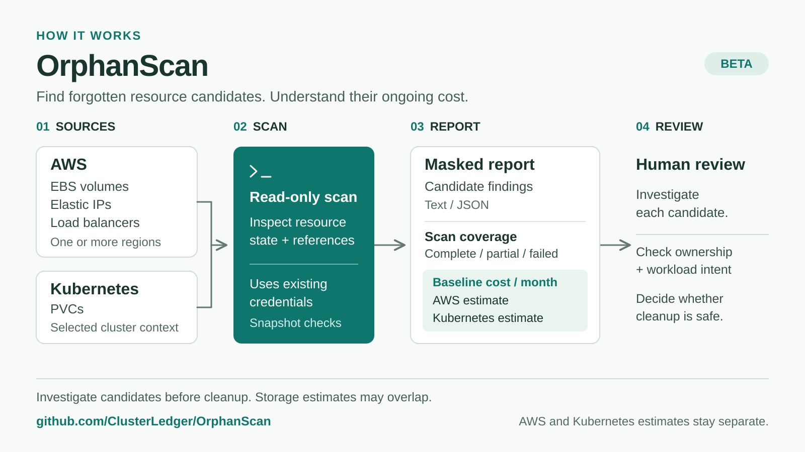

# OrphanScan

**Find forgotten AWS resources and Kubernetes storage candidates. Estimate their ongoing cost.**

[](https://github.com/ClusterLedger/OrphanScan/actions/workflows/test.yml)
[](https://github.com/ClusterLedger/OrphanScan/actions/workflows/lint.yml)
[](LICENSE)

OrphanScan is a **read-only CLI in beta**. It uses your existing AWS credentials and Kubernetes configuration to find resource candidates for investigation. It makes no cloud or Kubernetes write or delete calls.

Findings use conservative snapshots and baseline prices. They do not establish that a resource is safe to delete or that the estimate equals your bill. AWS and Kubernetes storage estimates are shown separately because they can describe the same disk.

## How it works



[PNG for presentations and social posts](docs/images/orphanscan-overview.png).

## See a sample

This **synthetic example** is generated by the production report formatter. It is not a claim of measured customer savings.

```text
OrphanScan
Status: Complete

Sources
  AWS          Complete - 4 checks across 1 region
  Kubernetes   Complete - 1 check

Findings (candidates for review)
  AWS / us-east-1
    Unattached EBS volumes               1   $8.00/month
    Unassociated Elastic IPs             1   $3.60/month
    Load balancers without backends      1   $16.20/month
  Kubernetes
    PVC candidates                       1   $8.00/month

Unpriced reviews
  AWS / us-east-1: 1 load balancer flagged for investigation.
  Excluded from baseline estimates.

Monthly baseline estimates
  AWS          $27.80/month
  Kubernetes   $8.00/month

Estimates are separate; storage may overlap.
Baseline estimates. Review candidates before cleanup.
Use --verbose for check and pricing details.
```

See the full [text example](examples/report.txt), [JSON example](examples/report.json), and [credential-free demo](docs/usage.md#credential-free-demo).

## Install

Linux / macOS:

```bash
curl -fsSL https://raw.githubusercontent.com/ClusterLedger/OrphanScan/main/install.sh | sh
```

Or install with **Go 1.26.9 or newer**:

```bash
go install github.com/ClusterLedger/OrphanScan/cmd/orphanscan@latest
```

The installer requires a published [GitHub Release](https://github.com/ClusterLedger/OrphanScan/releases). Before the first release, [build from a clone](CONTRIBUTING.md#build-and-test). See the [installation guide](docs/installation.md) for Windows, supported architectures, checksums, pinned versions, and custom directories.

## Quick start

```bash
# Scan AWS and Kubernetes using your existing configuration
orphanscan

# AWS only
orphanscan --sources=aws

# Kubernetes only
orphanscan --sources=kubernetes
```

With no arguments, both AWS and Kubernetes are requested:

- **AWS:** scans one credential identity, using the configured region or discovering enabled regions when none is configured.
- **Kubernetes:** uses the current context, scanning across its namespaces.
- **Output:** a masked text report with separate AWS and Kubernetes baseline cost estimates.

An unavailable source makes the scan incomplete and produces a nonzero exit code. Select only the sources you intend to scan. For profiles, all-region scans, JSON output, and other options, see the [usage guide](docs/usage.md).

## What it detects

- Unattached EBS volume candidates.
- Unassociated Elastic IPs.
- Classic, Application, Network, and Gateway load balancers with no registered backends.
- Bound Kubernetes PVC candidates without existing Pod references.

Investigate findings before cleanup; reserved storage, scaled-down workloads, and load balancer redirects can be intentional. See the [exact detection rules, limitations, and pricing assumptions](docs/detection-and-pricing.md).

## Permissions and privacy

Use the documented [read-only IAM and Kubernetes RBAC permissions](docs/permissions/README.md). Resource identifiers are masked with no reveal flag; see the [credential handling and security policy](SECURITY.md#credential-handling).

Optional scan metrics are **off until explicit consent**. A saved opt-in also applies to noninteractive scans. See [what is sent and how to opt out](docs/telemetry.md).

## Documentation

- [Installation: platforms, checksums, and version pinning](docs/installation.md)
- [Usage: regions, profiles, flags, and troubleshooting](docs/usage.md)
- [Detection rules, limitations, and baseline pricing](docs/detection-and-pricing.md)
- [Report format, completion status, and exit codes](docs/report-format.md)
- [Read-only permissions and setup](docs/permissions/README.md)
- [Optional scan metrics and privacy](docs/telemetry.md)

## Contributing

See the [contributor guide](CONTRIBUTING.md) and [changelog](CHANGELOG.md).

## License

[Apache License 2.0](LICENSE). Built by [ClusterLedger](https://github.com/ClusterLedger).
